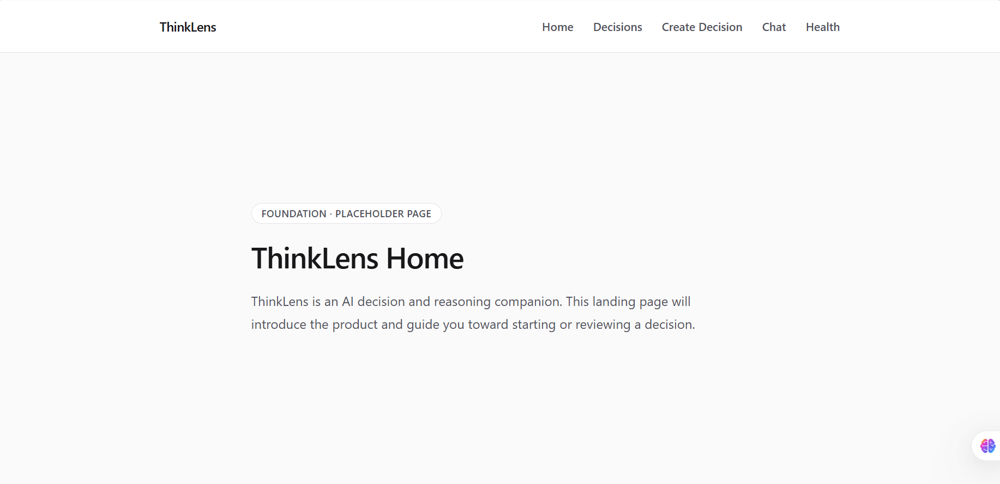
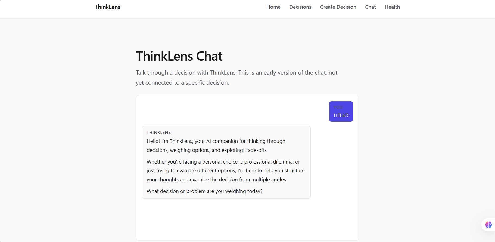
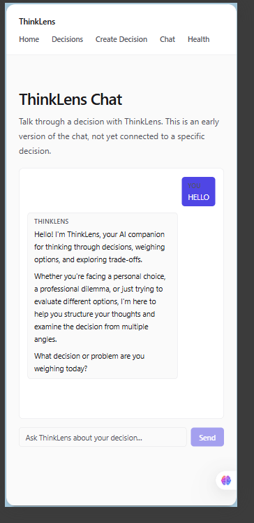

# ThinkLens — AI Decision & Reasoning Companion

ThinkLens is an AI-powered decision-support application that helps users organize decisions, compare alternatives, examine assumptions, and reason through their options.

The project is being developed as part of the **FlyRank AI Frontend Engineering Internship**.

## Features

- **Structured decision-making:** Organize decisions, alternatives, criteria, and constraints.
- **AI-powered streaming chat:** Interact with an AI assistant through a streaming chat interface.
- **Decision analysis:** Generate structured decision-analysis results with weighted scoring and comparisons.
- **AI score suggestions:** Request AI-generated scores and reasoning for decision alternatives, then review suggestions before using them.
- **Input validation:** Validate API requests and decision-analysis data before processing.
- **Rate limiting:** Protect the chat and score-suggestion endpoints against excessive requests using Upstash.
- **Error handling:** Display user-friendly errors when AI generation or supporting services fail.
- **Responsive interface:** Use the application across different screen sizes.

## Technology Stack

- **Framework:** Next.js
- **UI library:** React
- **Language:** TypeScript
- **Styling:** Tailwind CSS
- **AI integration:** Vercel AI SDK
- **AI model provider:** Google Gemini
- **Rate limiting:** Upstash Redis and Upstash Ratelimit
- **Testing:** Vitest

## Getting Started

### Prerequisites

- Node.js compatible with the project configuration
- npm
- A Google Gemini API key
- Upstash Redis REST credentials for testing the rate-limited API endpoints locally

### Installation

Clone the repository:

```bash
git clone https://github.com/MindfullLearner/AI-frontend-Capstone.git
cd AI-frontend-Capstone
```

Install the dependencies:

```bash
npm install
```

### Environment Variables

Create a `.env.local` file in the project root.

Use `.env.example` as the reference for the required variable names, then add your own credentials:

- Google Gemini API key
- Upstash Redis REST URL
- Upstash Redis REST token

Use the exact variable names defined in `.env.example` and the application's configuration.

**Security:** Never commit `.env.local`, expose API keys in source code, or publish credentials in screenshots, logs, or documentation. Configure the corresponding environment variables in Vercel for deployed environments.

### Run Locally

Start the development server:

```bash
npm run dev
```

Open [http://localhost:3000](http://localhost:3000) in your browser.

## Testing and Quality Checks

Run the automated test suite:

```bash
npx vitest run
```

Run the TypeScript check:

```bash
npx tsc --noEmit
```

Run the linter:

```bash
npm run lint
```

Build the application for production:

```bash
npm run build
```

To run the production build locally, execute:

```bash
npm run start
```

Run `npm run build` before `npm run start`.

During the latest rate-limiting development work, the TypeScript check, linter, production build, and all **42 automated tests across 6 test files** passed locally.

## API Reliability and Security

### Chat API

The chat endpoint includes:

- A maximum request-body size of 1 MB.
- A maximum of 50 messages per request.
- Validation of incoming UI messages.
- HTTP 400 responses for malformed JSON and invalid request structures.
- A configured maximum route duration of 30 seconds.
- Limited AI SDK retries and server-side logging of streaming errors.
- Rate limiting through the shared Upstash rate-limiting utility.

### AI Score Suggestions

The score-suggestion endpoint includes request validation, checks for invalid or inconsistent AI-generated suggestions, error handling, and Upstash rate limiting.

### Rate-Limiting Behavior

The current shared rate limiter allows **up to 5 requests per minute per identified client IP**. Chat and score-suggestion requests use the same limiter, so requests to either endpoint count toward that shared limit.

Requests that exceed the limit receive HTTP 429 with a `Retry-After` header. Requests that cannot be protected because the client IP is unavailable or the rate-limiting service fails are rejected rather than processed without protection.

These safeguards reduce excessive requests but do not eliminate temporary failures from the upstream AI provider or other external services.

## Architecture Overview

- `src/app/` — Next.js pages, layouts, and application routes.
- `src/app/api/chat/route.ts` — Chat request validation, rate limiting, and AI streaming.
- `src/app/api/decisions/analyze/route.ts` — Decision-analysis API endpoint.
- `src/app/api/decisions/suggest-scores/route.ts` — AI score-suggestion endpoint.
- `src/app/components/` — Application UI components.
- `src/lib/ai/` — AI configuration, decision-analysis tools, and rate-limiting utilities.

## AI Usage and Development Decisions

AI assistance was used during implementation, debugging, and code review. Changes were evaluated through manual checks, automated tests, and production builds.

During development, a temporary HTTP 503 response from the Gemini API demonstrated that upstream AI services can fail even when the application builds and runs successfully.

A remote Google-hosted font import was also removed after causing a font compilation failure in the local build environment. The application uses CSS/system font fallbacks instead.

## Screenshots

Add screenshots to the repository's `screenshots/` directory using these filenames:

### Homepage



### Successful Chat Response



### Responsive Mobile Layout



*Ensure the screenshot files exist at these exact paths and that they do not expose API keys or other sensitive information.*

## Deployment

ThinkLens is deployed through Vercel. The production deployment uses the `feature/production-polish` branch.

The deployed application requires its environment variables to be configured in Vercel. A successful build confirms that the application compiles, while production testing is needed to verify runtime behavior and external service connectivity.

## License

See the repository's `LICENSE` file for licensing terms.
